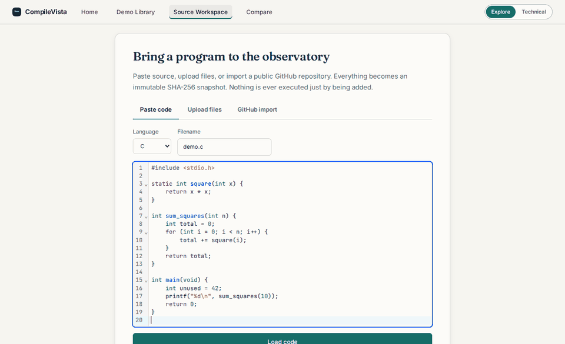
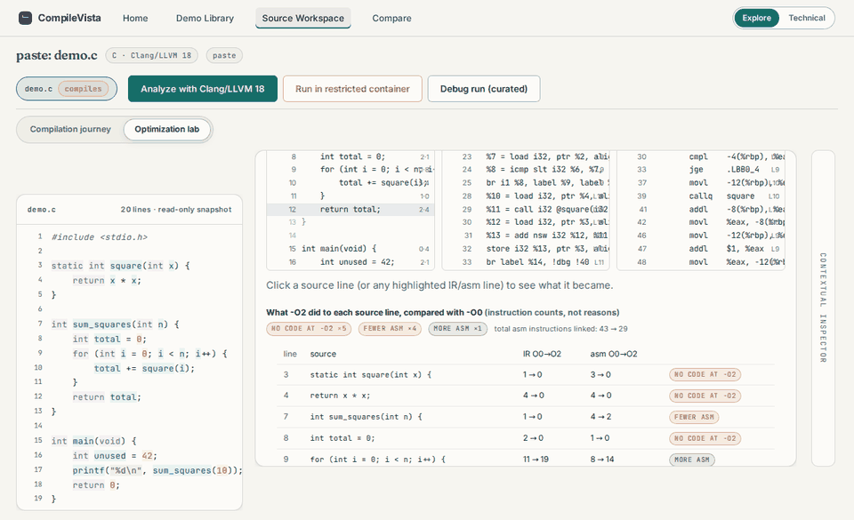
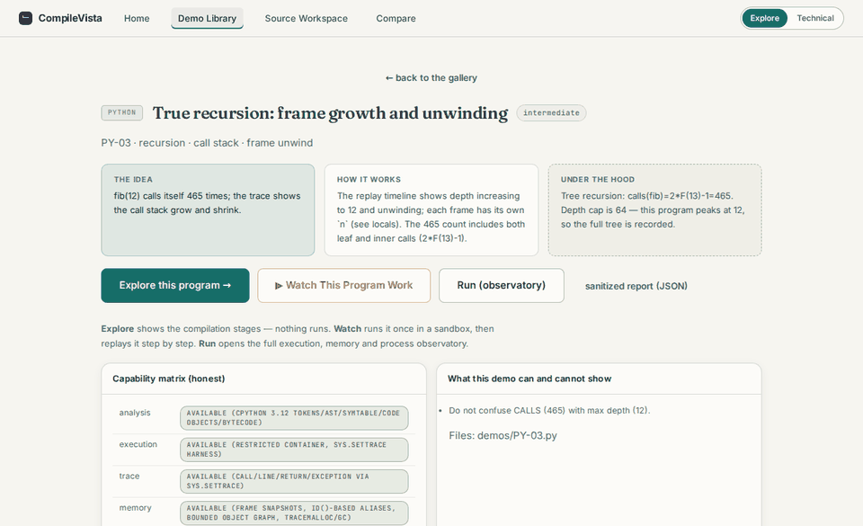

# CompileVista

**See how code becomes execution.** CompileVista is a local-first observatory that shows the
*real* artifacts a toolchain produces for code you bring: tokens, syntax trees, LLVM IR,
assembly and objects for **C** (Clang/LLVM 18), and tokens, AST, code objects and bytecode for
**Python** (CPython 3.12) - plus a recorded, replayable run of the program in a sandbox.

Nothing is simulated. Every artifact carries the tool and version that produced it, the
invocation, the exit code and a SHA-256; when a tool cannot provide something, the UI says
"unavailable" instead of making it up.

## See it work

**From pasted code to every compiler stage** (tokens, syntax tree, LLVM IR, assembly):



**Source ↔ LLVM IR ↔ assembly**, linked from the compiler's own debug info, with -O0 vs -O2:



**Watch a program work** - a sandboxed run, replayed step by step:



*(Recorded from the real app by `scripts/media/make_gifs.py`; nothing is mocked.)*

## What you can do

- **Paste, upload or import** C/Python code (a CodeMirror editor, ZIP upload, or a public GitHub repo) and step through the compilation journey stage by stage.
- **Click any AST node, token or instruction** to see the source line it came from.
- **Source ↔ IR ↔ assembly linking** (C): pick a source line and see the IR and assembly instructions the compiler attributed to it, with an **-O0 vs -O2 comparison** of what happened to each line. Links come from the compiler's own debug info.
- **Watch a program work**: it runs once in a restricted container; the recorded call/line/return events replay step by step with the call stack and values.
- **Export a replay** as a single HTML file that plays back with no backend and no network.
- **Explore 20 curated programs** (5 Python, 5 C, 5 matched C/Python pairs) and an Error Microscope of real compiler diagnostics.
- **Compare C and Python** on the same problem - without pretending Python has LLVM optimization levels.

## Quick start (Windows 11)

Prerequisites: WSL2 with Ubuntu 24.04, Docker Desktop (WSL 2 engine). See
[docs/LOCAL_RUN_GUIDE.md](docs/LOCAL_RUN_GUIDE.md) for the details.

1. Double-click **`Setup.cmd`** once. It checks prerequisites, creates the backend virtual
   environment, installs frontend dependencies and builds the three sandbox images.
2. Double-click **`Start.cmd`**. The app opens at <http://127.0.0.1:5173/>.
3. **`Stop.cmd`** stops only what the launcher started.

Everything binds to `127.0.0.1`. This is a local tool, not a hosted service.

## How it is built

| Part | Technology |
|---|---|
| Backend | FastAPI, SQLite metadata + content-addressed artifacts |
| Analysis & execution | Three pinned Docker images (analyzer/builder, runtime, debug); no network, read-only root, dropped capabilities, resource limits, non-root |
| Frontend | React, TypeScript, Vite, React Flow, CodeMirror 6 |
| Tests | pytest (API, security, oracle checks against the real toolchains), Vitest unit tests for the pure logic, Playwright browser journeys, a layout test at seven viewport widths, an axe-core accessibility scan of 12 screens |

Design rules that shape the code:

- **Artifact honesty.** Artifacts are never invented; availability is an explicit state.
- **Distinct pipelines.** C and Python are separate - bytecode is not machine code.
- **Static analysis never executes code.** Execution happens only inside the sandbox.

More: [architecture](docs/ARCHITECTURE.md) · [security notes](docs/SECURITY.md) ·
[API contracts](docs/API_CONTRACTS.md) · [user guide](docs/USER_GUIDE.md).

## Verifying it yourself

```bash
# backend tests (from the repository root, inside WSL)
backend/.venv/bin/python -m pytest backend/tests -q

# do the displayed artifacts match what the real tools produce? (needs Docker)
backend/.venv/bin/python eval/fidelity_study.py
```

## Limitations

- Local, single-user; not hardened for public hosting.
- C execution traces are function-level (call/return); only Python traces carry line events.
- Source ↔ IR/asm links depend on `-g` debug info; inlined code is attributed to the callee's source line.
- The browser tests cover the main journeys, not every panel.

## License

MIT, see [LICENSE](LICENSE). Copyright (c) 2026 Ayush Khanal.
